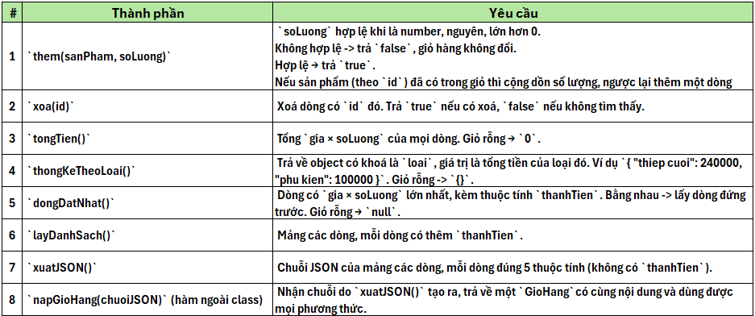
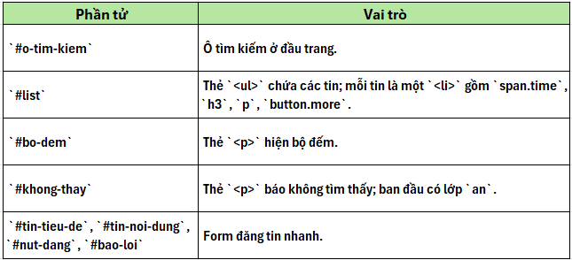

Bài tập 2:
Tải bộ mã nguồn Bài tập 2 dưới đây về máy tính. Yêu cầu của bài tập này là website cần xây dựng:
2a. trang News load danh sách bài đăng từ dữ liệu JSON, có thống kê lượt xem và thẻ (tag).
File js/bai-a-tin-tuc.js có các chỗ trống được đánh số, cần điền vào các chỗ trống này. Chỗ trống nằm trong code thì điền tên phương thức, từ khoá, toán tử hoặc biểu thức còn thiếu. Chỗ trống nằm trong chú thích thì điền kết quả dự đoán.
Khi điền đúng thì trang news.html hiện 4 bài đã đăng load từ dữ liệu mẫu.
2b. trang chủ Home có giỏ hàng ở cột bên phải, lưu lại dữ liệu dưới dạng JSON để lần sau khách có thể mở lại.
File js/bai-b-gio-hang.js đã có danh mục sản phẩm `DANH_MUC` và khung `class GioHang`.
Kiểm thử: mở `index.html`; bộ kiểm tra js/kiem-tra.js chạy 20 testcases (T1–T20). Khi làm đúng, ô Giỏ hàng ở cột bên phải hiện 2 dòng sản phẩm và dòng `Tổng: 325000 đ`.
Giỏ hàng lưu các dòng trong `this.dsDong`; mỗi dòng là một object có 5 thuộc tính: `id`, `ten`, `loai`, `gia`, `soLuong`.

Giỏ hàng không được làm xáo trộn danh mục: Sau khi thêm vào giỏ, các object trong `DANH_MUC` phải y nguyên: không thêm thuộc tính, không đổi giá trị.
Giỏ hàng không được phụ thuộc object bên ngoài: Sau khi `them(sp, 100)`, nếu ai đó sửa `sp.gia` thì tổng tiền của giỏ không đổi.
Bên ngoài không được sửa được giỏ hàng: Mảng và các object mà `layDanhSach()` và `dongDatNhat()` trả về phải là bản sao: sửa hay xoá trên đó không làm giỏ hàng thay đổi.

Bài tập 3:
Tải bộ mã nguồn Bài tập 3 dưới đây về máy tính. Yêu cầu của bài tập này là website cần xây dựng: tại trang chủ Home bấm ảnh nhỏ thì đổi ảnh lớn. Tại trang News gõ từ khóa trong ô tìm kiếm là lọc tin, bấm "Read more" là mở rộng, và nhân viên xưởng đăng được tin nhanh ngay trên trang.
3a. hoàn thành thư viện ảnh tương tác.
File js/bai-a-gallery.js có các chỗ trống được đánh số, cần điền vào các chỗ trống này. Chỗ trống nằm trong code thì điền tên phương thức, từ khoá, toán tử hoặc biểu thức còn thiếu. Chỗ trống nằm trong chú thích thì điền kết quả dự đoán.
Khi điền đúng trên trang `index.html` có các hiệu ứng:
Dưới ảnh lớn có dòng chú thích Bấm vào ảnh nhỏ để đổi ảnh lớn.
Bấm một ảnh nhỏ: ảnh lớn đổi, chú thích thành `Đang xem: meeting.jpg` (hoặc `team-large.jpg`), ảnh nhỏ vừa bấm có viền.
Bấm vào khoảng trống giữa các ảnh nhỏ: không có gì xảy ra, console không hiện báo lỗi.
Bấm vào ô tìm kiếm: chữ gợi ý biến mất; rời khỏi ô khi chưa gõ gì: chữ gợi ý trở lại.
Bấm Khoá thư viện ảnh: bấm ảnh nhỏ không còn đổi ảnh lớn.
Cột bên phải có thêm một mục ở đầu danh sách.
3b. trang News có hiệu ứng lọc tin và đăng tin nhanh.
File js/bai-b-tin-nhanh.js cần điền code JS xử lý.
Kiểm thử: mở `news.html`, kéo xuống cuối trang, bấm Chạy kiểm tra Bài B (hoặc gõ `kiemTra()` trong Console). File js/kiem-tra.js giả lập thao tác người dùng bằng `dispatchEvent()` và chạy 18 testcases. Bộ kiểm tra có đăng vài tin thử, nên hãy tải lại trang (F5) sau mỗi lần chạy.
Các phần tử có sẵn trong news.html (lớp CSS đã định nghĩa sẵn: `an` (ẩn phần tử), `day-du` (đoạn văn hiện đầy đủ thay vì 2 dòng):

Mô tả chức năng xử lý:
F1. Bộ đếm: `#bo-dem` luôn hiện `Đang hiển thị x/y tin`, với `x` là số tin đang hiện, `y` là tổng số tin. Bộ đếm đúng ngay khi tải trang, sau mỗi lần lọc và sau mỗi lần đăng tin.
F2. Lọc tin khi gõ: sự kiện `keyup` trên `#o-tim-kiem`.
Một tin khớp khi từ khoá xuất hiện trong tiêu đề (`h3`) hoặc nội dung (`p`), không phân biệt hoa thường.
Tin không khớp: `<li>` nhận lớp `an`; tin khớp: `<li>` không có lớp `an`.
Từ khoá rỗng: hiện tất cả.
F3. Thông báo không tìm thấy
Không tin nào khớp: `#khong-thay` bỏ lớp `an` và có nội dung đúng là `Không tìm thấy tin nào cho "<từ khoá>"`.
Có ít nhất một tin khớp: `#khong-thay` có lớp `an`.
Từ khoá do người dùng gõ phải hiện nguyên văn: gõ `<b>x</b>` thì thấy đúng 8 ký tự đó, không thấy chữ đậm.
F4. Mở rộng / thu gọn:
Bấm nút `Read more >>` của một tin: thẻ `
` của tin đó nhận lớp `day-du`, chữ trên nút đổi thành `Thu gọn <<`.
Bấm lần nữa: bỏ lớp `day-du`, chữ trên nút trở lại `Read more >>`.
Bấm vào tiêu đề, đoạn văn hay khoảng trống của tin: không có gì thay đổi.
Chỉ được đăng ký một trình lắng nghe `click`, đặt trên `#list`.
F5. Đăng tin nhanh: sự kiện `click` trên `#nut-dang`.
Nếu tiêu đề hoặc nội dung là chuỗi rỗng: `#bao-loi` hiện `Vui lòng nhập đủ tiêu đề và nội dung.` và không thêm tin.
Ngược lại, tạo một `<li>` mới có cấu trúc giống hệt các tin có sẵn và chèn vào đầu `#list`:
``: ngày hôm nay, lấy bằng hàm `homNay()` đã cho trong `ho-tro.js`;
`<h3>`: tiêu đề; `
`: nội dung;
`<button type="button" class="more">` với chữ `Read more >>`.
Tiêu đề và nội dung do người dùng nhập phải hiện nguyên văn, kể cả khi chứa `` hay `<script>`.
Sau khi đăng: xoá trắng hai ô nhập, xoá `#bao-loi`.
Tin vừa đăng phải dùng được nút Read more và phải tuân theo bộ lọc đang gõ trong ô tìm kiếm (không khớp thì bị ẩn ngay).
